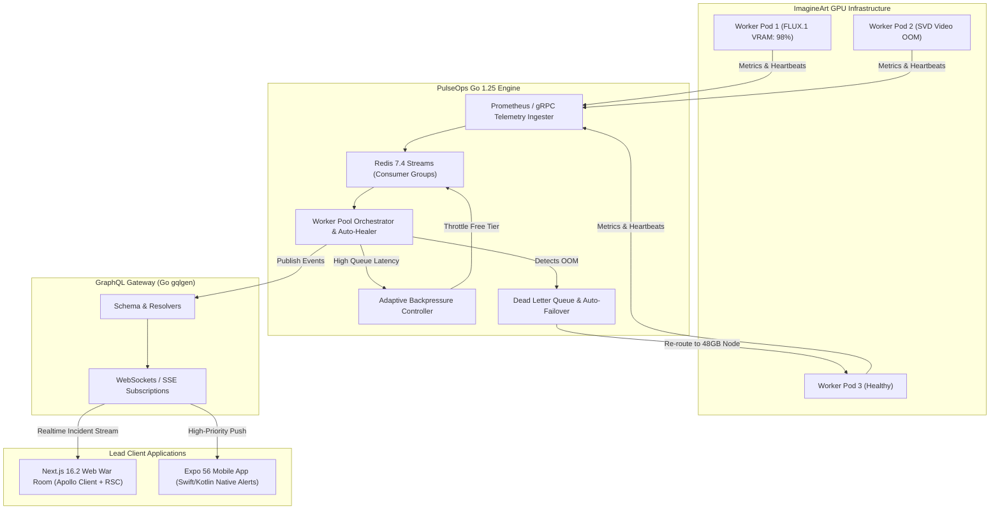

# SPEC-01: PulseOps AI — System Architecture & Monorepo Blueprint

## 1. Executive Summary & Problem Domain
**PulseOps AI** is an Autonomous Inference Fleet & Incident Commander designed for high-scale GenAI platforms (Fortune 500 / $35M+ ARR scale). In large-scale GenAI infrastructure (e.g. ImagineArt), thousands of GPU worker nodes run diffusion and video models. Failures such as CUDA Out-of-Memory (OOM), driver timeouts, inference deadlocks, and queue saturation cost tens of thousands of dollars per hour.

PulseOps AI continuously ingests real-time telemetry, auto-triages GPU failures via Go-based asynchronous pipelines, enforces dynamic queue backpressure, and provides cross-platform incident command across **Web (Next.js 16.2)** and **Mobile (Expo SDK 56 / React Native 0.85)** via **GraphQL Subscriptions**.

---

## 2. Global Technology Matrix (2026 Standards)

| Tier | Component | Specification | Rationale |
| :--- | :--- | :--- | :--- |
| **Monorepo** | Workspace Manager | **Turborepo 2.x + pnpm 9.x** | Zero-config remote caching, symlinked TypeScript packages. |
| **Web Client** | Web Framework | **Next.js 16.2.6** (App Router, Turbopack) | React 19.2 compiler, Server Actions v2, partial prerendering (`ppr: true`). |
| **Web UI** | Styling & UI Primitives | **Tailwind CSS v4** + **shadcn/ui** | Zero-runtime CSS engine, OKLCH color palettes, full tokenization. |
| **Mobile Client** | Mobile Framework | **Expo SDK 56** (React Native 0.85.3) | Bridgeless New Architecture default, React 19 concurrent features. |
| **Mobile Motion** | Gesture & Animation | **Reanimated 4.x** + **Moti 0.30+** | Worklet-driven 60fps animations on UI thread. |
| **API & Data** | GraphQL Gateway | **Go 1.25+ (`gqlgen`)** + **`graphql-ws`** | High-concurrency compiled binary, zero-overhead WebSockets. |
| **Data Layer** | Client SDK & Codegen | **Apollo Client 3.12+** + **`@graphql-codegen` v5** | Strongly-typed React hooks, normalized cache (`InMemoryCache`). |
| **Pipeline Engine** | Core Daemon | **Go 1.25+** (goroutine worker pools) | Sub-millisecond latency, zero-garbage-collection hotspots. |
| **Queue & Streams** | Message Broker | **Redis 7.4+ Streams (Valkey) / Redpanda** | Consumer groups, `XAUTOCLAIM`, sub-millisecond dispatch. |
| **Native Modules** | Mobile Platform Hooks | **Swift (iOS 18)** & **Kotlin (Android 15)** | iOS Live Activities / Critical Alerts; Android Foreground Notification. |
| **Database** | Persistent Storage | **PostgreSQL 17 + TimescaleDB extension** | High-cardinality time-series metrics & audit logs. |

---

## 3. Monorepo Directory Topology

```text
pulseops-ai/
├── .github/
│   └── workflows/
│       ├── ci.yml                 # Lint, Typecheck, Unit Tests (Vitest & Go test)
│       └── e2e.yml                # Playwright (Web) & Maestro (Mobile)
├── apps/
│   ├── web/                       # Next.js 16.2.6 Web Application
│   │   ├── app/                   # App Router (incidents, cluster, analytics)
│   │   ├── components/            # Web-specific UI (Mermaid, Canvas, Virtual lists)
│   │   └── package.json
│   └── mobile/                    # Expo SDK 56 / React Native 0.85 Mobile App
│       ├── app/                   # Expo Router 56 file-based navigation
│       ├── modules/native-alert/  # Swift (iOS) & Kotlin (Android) custom module
│       └── package.json
├── packages/
│   ├── api-graphql/               # Go gqlgen schema definitions & resolver interfaces
│   ├── graphql-codegen/           # Shared typed hooks generated from schema.graphql
│   ├── ui/                        # Cross-platform design tokens (colors, typography, icons)
│   └── tsconfig/                  # Strict base TypeScript configurations
├── services/
│   ├── orchestrator-go/           # Go 1.25 Pipeline & GPU Fleet Manager
│   │   ├── cmd/server/            # Main entrypoint
│   │   ├── internal/backpressure/ # Dynamic token bucket & queue rate limiting
│   │   ├── internal/workerpool/   # Goroutine worker pool & GPU health checker
│   │   └── internal/queue/        # Redis Streams consumer group logic
│   └── telemetry-collector/       # Prometheus / OpenTelemetry ingestion daemon
├── docs/
│   ├── adr/                       # Architecture Decision Records
│   └── specs/                     # Spec-Driven Development documentation
├── turbo.json
└── pnpm-workspace.yaml
```

---

## 4. End-to-End Data & Execution Flow


