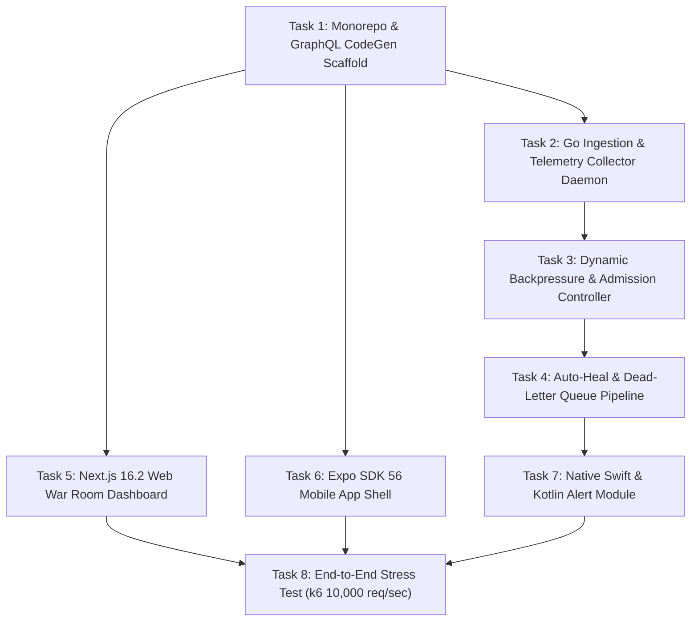

# SPEC-06: PulseOps AI — Step-by-Step Agentic Implementation Plan & Execution DAG

## 1. SDD Execution Protocol & Grounding Rules
1. **Contract Invariance:** `SPEC-03-GRAPHQL-SCHEMA.graphql` is the single source of truth for all API interactions.
2. **Deterministic Task Gates:** Every task has an automated verification command that must return exit code 0 before proceeding.

---

## 2. Dependency Graph (Execution DAG)

---

## 3. Work Breakdown Structure & Verification Gates

### Phase 1: Contracts & Scaffolding
- [ ] **Task 1.1: Turborepo + pnpm Setup**
  - Setup `apps/web`, `apps/mobile`, `packages/api-graphql`, `packages/graphql-codegen`.
  - *Verification:* `pnpm install && pnpm build` passes with zero warnings.
- [ ] **Task 1.2: GraphQL CodeGen Generation**
  - Compile `SPEC-03-GRAPHQL-SCHEMA.graphql` into React 19 Apollo hooks.
  - *Verification:* `pnpm --filter @pulseops/graphql-codegen run generate` produces valid TypeScript types.

### Phase 2: High-Concurrency Go Fleet Engine
- [ ] **Task 2.1: Telemetry Ingestion Gateway**
  - High-throughput gRPC / HTTP collector in Go ingesting GPU metrics into Redis Streams.
  - *Verification:* `go test -race ./services/orchestrator-go/internal/telemetry/...`
- [ ] **Task 2.2: Admission Controller & Backpressure**
  - Token bucket rate limiter that throttles lower tiers when p99 latency > 1,200ms.
  - *Verification:* Unit test validating tier throttling under simulated high latency.
- [ ] **Task 2.3: Auto-Heal & DLQ Pipeline**
  - Catches CUDA OOM (code 137), drains node, and re-routes tasks to larger VRAM workers.
  - *Verification:* Integration test simulating worker failure and automatic task recovery.

### Phase 3: Clients & Native Integrations
- [ ] **Task 3.1: Next.js 16.2 War Room**
  - Real-time incident list with `@tanstack/react-virtual` and Apollo subscriptions.
  - *Verification:* Web dashboard displays live updating incidents at `localhost:3000`.
- [ ] **Task 3.2: Native Swift & Kotlin Incident Alerts**
  - Swift module for iOS 18 Dynamic Island & Critical Alerts; Kotlin for Android 15 Heads-up channel.
  - *Verification:* Trigger simulated critical incident; test receipt on native simulator.
